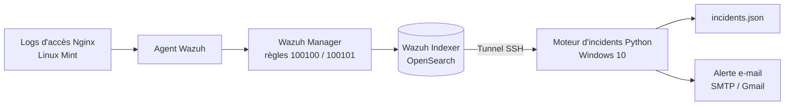

# SOC Incident Management Engine

> Un home lab SOC léger : Wazuh détecte les attaques d'énumération web, et un moteur Python corrèle les alertes en incidents, calcule leur niveau de risque, les associe à MITRE ATT&CK et envoie un e-mail à l'analyste.

[🇬🇧 Read in English](README.md)

## Présentation

Ce projet surveille un serveur web Linux avec **Wazuh**, détecte les activités web suspectes grâce à des **règles de détection personnalisées**, et traite les alertes générées avec un **moteur d'incidents en Python**.

Au lieu de traiter chaque alerte séparément, le moteur :

- **Corrèle** les alertes liées en un seul incident
- **Évalue** chaque incident avec un score de risque pour le prioriser
- **Enrichit** l'incident avec le contexte MITRE ATT&CK
- **Notifie** l'analyste par e-mail lorsqu'un seuil de risque est atteint
- **Stocke** chaque incident dans un format JSON structuré

Il a été réalisé comme un home lab de cybersécurité pour pratiquer la supervision de sécurité, l'ingénierie de détection, la corrélation d'alertes et la gestion d'incidents.

## Démonstration

| Alertes Wazuh | Notification par e-mail | Fiche d'incident |
|---|---|---|
| [Voir la capture](screenshots/wazuh-dash.jpeg) | [Voir la capture](screenshots/email.jpeg) | [Voir la capture](screenshots/engine-json.jpeg) |

## Objectifs

- Déployer un environnement de supervision centralisé avec Wazuh
- Collecter les événements de sécurité d'un serveur web Linux
- Écrire des règles de détection personnalisées pour les activités web suspectes
- Développer un moteur Python qui récupère et corrèle les alertes
- Prioriser les incidents grâce à un score de risque
- Enrichir les incidents avec les informations MITRE ATT&CK
- Générer des fiches d'incident structurées en JSON
- Notifier l'analyste par e-mail en cas d'incident significatif

## Architecture



<!-- TODO : vérifier que ce schéma correspond à votre architecture réelle (où tournent le manager et l'indexer), ou garder votre image d'origine. -->

## Technologies utilisées

| Technologie | Rôle |
|---|---|
| **Wazuh** | Supervision de sécurité et génération d'alertes |
| **OpenSearch** | Stockage et récupération des alertes (Wazuh Indexer) |
| **Python** | Corrélation, calcul du risque et automatisation |
| **Linux Mint + Nginx** | Serveur web surveillé et génération des logs |
| **Windows 10** | Hôte exécutant le moteur Python |
| **Tunnel SSH** | Liaison sécurisée entre l'hôte et le Wazuh Indexer |
| **MITRE ATT&CK** | Classification et enrichissement |
| **SMTP / Gmail** | Notifications par e-mail |
| **JSON** | Stockage des incidents |

## Règles de détection personnalisées

| Règle | Détecte | Logique | Niveau | MITRE ATT&CK |
|---|---|---|---|---|
| **100100** | Énumération de répertoires / fichiers web | Réponses HTTP 404 répétées depuis une même IP source en 60 secondes, avec un grand nombre d'URL distinctes demandées | 10 | T1595.003 Wordlist Scanning |
| **100101** | Outils de scan connus | User-Agents suspects : ffuf, Gobuster, Feroxbuster, Dirbuster, Dirb, Wfuzz, Nikto | 8 | T1595.003 Wordlist Scanning |

> Le mapping MITRE ATT&CK fournit un contexte comportemental. Il ne prouve pas qu'une attaque a eu lieu.

## Moteur d'incidents Python

### 1. Récupération des alertes
Le moteur se connecte au Wazuh Indexer via un tunnel SSH et interroge périodiquement l'API OpenSearch pour récupérer les alertes déclenchées par les règles personnalisées.

### 2. Corrélation
Les alertes sont regroupées en un incident lorsqu'elles partagent :
- la même **adresse IP source**
- le même **agent ciblé**
- une **fenêtre de corrélation de cinq minutes**

### 3. Calcul du risque
Chaque incident reçoit un score basé sur :
- la sévérité et le type de règle
- le nombre d'alertes liées
- le nombre d'URL distinctes demandées

<!-- TODO : ajouter votre formule ou vos seuils, par ex. les poids de chaque facteur et le score qui déclenche un e-mail. -->

### 4. Gestion des incidents
Pour chaque incident, le moteur crée une fiche unique, ajoute le contexte MITRE ATT&CK, l'enregistre dans `incidents.json`, et suit les alertes déjà traitées dans `processed_alerts.json` pour éviter les doublons.

### 5. Notification par e-mail
Lorsque le seuil de risque est atteint, l'analyste reçoit un e-mail via SMTP Gmail contenant :
- l'identifiant de l'incident et son score de risque
- l'IP source et l'agent ciblé
- les règles déclenchées, le nombre d'alertes et la chronologie
- les URL demandées
- la tactique et la technique MITRE ATT&CK
- les actions recommandées d'investigation et de réponse

## Exemple de scénario

1. Un attaquant lance `ffuf` contre le serveur web.
2. Nginx enregistre de nombreuses requêtes 404 avec le User-Agent `ffuf`.
3. Les règles **100100** et **100101** se déclenchent dans Wazuh.
4. Le moteur regroupe ces alertes en **un seul incident** (même IP, même agent, fenêtre de 5 minutes).
5. Le score dépasse le seuil : l'analyste reçoit un e-mail et l'incident est enregistré dans `incidents.json`.

## Installation

**Prérequis**
- Un déploiement Wazuh fonctionnel (manager, indexer, agent sur le serveur web)
- Python 3.x sur la machine qui exécute le moteur
- Un accès SSH à l'hôte du Wazuh Indexer
- Un compte Gmail avec un mot de passe d'application pour le SMTP

```bash
git clone https://github.com/<username>/<repo>.git
cd <repo>
pip install -r requirements.txt
```

**Règles Wazuh :** copier les règles personnalisées dans `/var/ossec/etc/rules/local_rules.xml` sur le manager, puis le redémarrer :

```bash
sudo systemctl restart wazuh-manager
```

## Configuration

<!-- TODO : adapter les noms à votre fichier de configuration ou à vos variables réelles. -->

| Paramètre | Description |
|---|---|
| Hôte / port de l'indexer | Port local du tunnel SSH vers le Wazuh Indexer |
| Identifiants de l'indexer | Utilisateur en lecture seule pour interroger les alertes |
| Utilisateur SMTP / mot de passe d'application | Compte Gmail utilisé pour envoyer les notifications |
| E-mail de l'analyste | Destinataire des alertes |
| Seuil de risque | Score à partir duquel un e-mail est envoyé |

> **Ne jamais publier d'identifiants sur GitHub.** Utilisez des variables d'environnement ou un fichier de configuration listé dans `.gitignore`.

## Utilisation

```bash
# 1. Ouvrir le tunnel SSH vers le Wazuh Indexer
ssh -L 9200:localhost:9200 <user>@<wazuh-host>

# 2. Lancer le moteur
python main.py
```

<!-- TODO : remplacer par vos vraies commandes et votre fichier d'entrée. -->

## Structure du projet

```
.
├── README.md
├── README.fr.md
├── realtime_engine.py                  # incident engine (adapt to your files)
├── screenshots/
├── incidents.json           # generated incident records
├── processed_alerts.json    # already-processed alerts          
└── engine.log     
```

## Limites et améliorations futures

**Limites actuelles**
- La détection ne couvre que l'énumération web (deux règles)
- Le score de risque est basé sur des règles fixes, pas adaptatif
- Le moteur interroge l'indexer à intervalles réguliers au lieu de réagir en temps réel
- Les incidents sont stockés dans un fichier JSON local

**Améliorations possibles**
- Ajouter des règles pour d'autres attaques (brute force, injection SQL, XSS)
- Stocker les incidents dans une base de données
- Ajouter un tableau de bord de visualisation des incidents
- Ajouter une réponse automatisée (par ex. blocage de l'IP source)
- Enrichir les IP avec des sources de threat intelligence
- Ajouter des tests unitaires pour la corrélation et le scoring

## Auteur

**Hazan**, étudiant en informatique spécialisé en cybersécurité.
