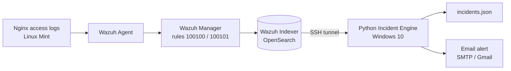

# SOC Incident Management Engine

> A lightweight SOC home lab: Wazuh detects web enumeration attacks, and a Python engine correlates the alerts into incidents, scores their risk, maps them to MITRE ATT&CK and emails the analyst.

[🇫🇷 Lire en français](README.fr.md)

## Overview

This project monitors a Linux web server with **Wazuh**, detects suspicious web activity using **custom detection rules**, and processes the resulting alerts with a **Python incident engine**.

Instead of treating every alert on its own, the engine:

- **Correlates** related alerts into a single incident
- **Scores** each incident by risk to help prioritize it
- **Enriches** it with MITRE ATT&CK context
- **Notifies** the analyst by email when a risk threshold is reached
- **Stores** every incident as structured JSON

It was built as a hands-on cybersecurity home lab to practice security monitoring, detection engineering, alert correlation and incident management.

## Demo

| Wazuh alerts | Email notification | Incident record |
|---|---|---|
| [View screenshot](screenshots/wazuh-dash.jpeg) | [View screenshot](screenshots/email.jpeg) | [View screenshot](screenshots/engine-json.jpeg) |

## Objectives

- Deploy a centralized monitoring environment with Wazuh
- Collect security events from a Linux web server
- Write custom detection rules for suspicious web activity
- Build a Python engine that retrieves and correlates alerts
- Prioritize incidents with a risk-based score
- Enrich incidents with MITRE ATT&CK information
- Generate structured incident records in JSON
- Notify the analyst by email for significant incidents

## Architecture



<!-- TODO: check this diagram matches your real setup (where the manager and indexer run), or keep your original image. -->

## Technologies

| Technology | Purpose |
|---|---|
| **Wazuh** | Security monitoring and alert generation |
| **OpenSearch** | Storage and retrieval of alerts (Wazuh Indexer) |
| **Python** | Correlation, risk scoring and automation |
| **Linux Mint + Nginx** | Monitored web server and access logs |
| **Windows 10** | Host running the Python engine |
| **SSH tunnel** | Secure link between the host and the Wazuh Indexer |
| **MITRE ATT&CK** | Classification and enrichment |
| **SMTP / Gmail** | Email notifications |
| **JSON** | Incident storage |

## Custom Detection Rules

| Rule | Detects | Logic | Level | MITRE ATT&CK |
|---|---|---|---|---|
| **100100** | Web directory / file enumeration | Repeated HTTP 404 responses from one source IP within 60 seconds, with a high number of distinct requested URLs | 10 | T1595.003 Wordlist Scanning |
| **100101** | Known scanning tools | Suspicious User-Agent strings: ffuf, Gobuster, Feroxbuster, Dirbuster, Dirb, Wfuzz, Nikto | 8 | T1595.003 Wordlist Scanning |

> MITRE ATT&CK mapping gives behavioral context. It does not prove that an attack occurred.

## Python Incident Engine

### 1. Alert retrieval
The engine connects to the Wazuh Indexer through an SSH tunnel and periodically queries the OpenSearch API for alerts triggered by the custom rules.

### 2. Correlation
Alerts are grouped into one incident when they share:
- the same **source IP**
- the same **targeted agent**
- a **five-minute** correlation window

### 3. Risk scoring
Each incident gets a score based on:
- rule severity and type
- number of related alerts
- number of distinct URLs requested

<!-- TODO: add your formula or thresholds, e.g. weights per factor and the score that triggers an email. -->

### 4. Incident management
For each incident, the engine creates a unique record, adds MITRE ATT&CK context, saves it in `incidents.json`, and tracks handled alerts in `processed_alerts.json` to avoid duplicates.

### 5. Email notification
When the risk threshold is reached, the analyst receives an email via Gmail SMTP containing:
- incident ID and risk score
- source IP and targeted agent
- rules that fired, alert count and timeline
- requested URLs
- MITRE ATT&CK tactic and technique
- recommended investigation and response actions

## Example Scenario

1. An attacker runs `ffuf` against the web server.
2. Nginx logs many 404 requests with the `ffuf` User-Agent.
3. Rules **100100** and **100101** fire in Wazuh.
4. The engine groups these alerts into **one incident** (same IP, same agent, 5-minute window).
5. The score crosses the threshold, so the analyst gets an email and the incident is saved in `incidents.json`.

## Installation

**Prerequisites**
- A working Wazuh deployment (manager, indexer, agent on the web server)
- Python 3.x on the machine running the engine
- SSH access to the Wazuh Indexer host
- A Gmail account with an app password for SMTP

```bash
git clone https://github.com/<username>/<repo>.git
cd <repo>
pip install -r requirements.txt
```

**Wazuh rules:** copy the custom rules to `/var/ossec/etc/rules/local_rules.xml` on the manager, then restart it:

```bash
sudo systemctl restart wazuh-manager
```

## Configuration

<!-- TODO: adapt names to your real config file or variables. -->

| Setting | Description |
|---|---|
| Indexer host / port | Local port of the SSH tunnel to the Wazuh Indexer |
| Indexer credentials | Read-only user for querying alerts |
| SMTP user / app password | Gmail account used to send notifications |
| Analyst email | Recipient of the alerts |
| Risk threshold | Score at which an email is sent |

> **Never commit credentials.** Use environment variables or a config file listed in `.gitignore`.

## Usage

```bash
# 1. Open the SSH tunnel to the Wazuh Indexer
ssh -L 9200:localhost:9200 <user>@<wazuh-host>

# 2. Run the engine
python main.py
```

<!-- TODO: replace with your real commands and entry file. -->

## Project Structure

```
.
├── README.md
├── README.fr.md
├── realtime_engine.py                  # incident engine (adapt to your files)
├── screenshots/
├── incidents.json           # generated incident records
├── processed_alerts.json    # already-processed alerts          
└── engine.log     
```

## Limitations & Future Improvements

**Current limitations**
- Detection covers only web enumeration (two rules)
- Risk scoring is rule-based, not adaptive
- The engine polls the indexer instead of reacting in real time
- Incidents are stored in a local JSON file

**Possible improvements**
- Add rules for other attacks (brute force, SQL injection, XSS)
- Store incidents in a database
- Add a dashboard for incident visualization
- Add automated response (e.g. blocking the source IP)
- Enrich IPs with threat intelligence feeds
- Add unit tests for correlation and scoring

## Author

**Hazan**, computer science student specializing in cybersecurity.
